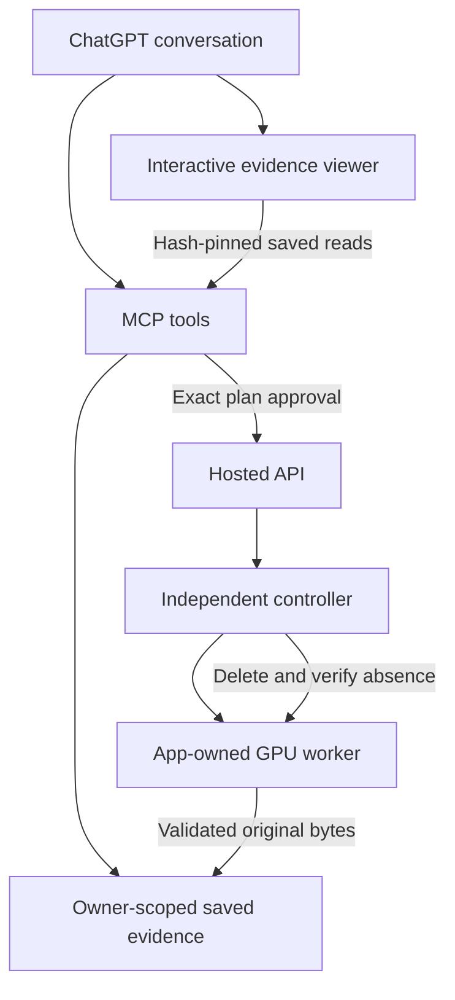

# ChatGPT app architecture

The app uses the workbench's native evidence format and existing worker coordinator. MCP adds bounded tools, account/profile ownership, explicit execution approval and a small interactive viewer.

## Two connection paths

**Private local connection.** `fork_microscope_workbench_mcp.py` selects one private profile at process startup. A local MCP client uses stdio; ChatGPT can reach the same process through an operator-configured Secure MCP Tunnel. Saved files and export directories are confined to that profile. Existing-worker tools use a private locally configured token; they do not provision a GPU or stop provider billing.

**Authenticated managed pilot.** `fork_microscope_hosted_mcp.py` and `hosted_pilot.py` require a real OAuth provider, authoritative access/revocation checks and a canonical link to the hosted account. The one-account pilot is an explicit deployment boundary. It is separate from the local stdio server; mounting the managed adapter does not grant the local server paid capabilities.

`pilot_cloud.py` combines the existing public hosted API, OAuth and evidence library. The private controller remains independent. Provider keys enter only the authenticated setup page and trusted vault. They do not enter tool arguments, viewer state or model-worker configuration.

## Evidence and viewer

`tools/evidence.py` validates native bundles, confines files and provides bounded inspection, deterministic reports and byte chunks. `tools/viewer_data.py` derives a bounded view from those same validated bytes. `tools/viewer.py` bundles a content-addressed MCP Apps resource from a fixed local source allowlist.

The viewer uses original token positions, recorded checkpoint counts, saved continuation text and explicit provenance. `measurements.mjs` owns the display's count and interval calculations. Smoothing is labeled as an estimate; the UI does not recompute a model or invent missing readouts.

Before export, `viewer.mjs` reassembles byte chunks and checks the complete SHA-256. Where available, the optional ChatGPT file APIs receive those verified bytes, prepare a temporary download link, and require a separate user action to open it. The URL stays private to the component's closure. Navigation is not proof of a device save. Hosts without those APIs can request a browser download where permitted; host restrictions still apply.

The saved viewer resource declares empty connection, resource and frame domain allowlists. It uses tool-mediated reads rather than direct API fetches. Actual-host verification and automated protocol checks are described in [validation](VALIDATION.md).

## Approval and lifecycle

`HostedService` binds the validated config, model revision, quote, worker image, destination, allowance, duration, credential reference and expiry into the approval digest. Approval atomically creates one session and one job. Stable request identities protect retries; an uncertain provider creation is reconciled rather than blindly repeated.

The worker journals ownership and workflow identity, publishes real progress and exposes bounded artifacts. Saving verifies format, identity, byte length and hash before acknowledging durable delivery. The pilot stores owner-bound manifests/chunks and verifies readback before commit; the generic adapter requires an explicitly confirmed durable volume.

Finish requests deletion of the app-owned pod. Cleanup is complete only after the provider confirms absence. Deadline cleanup can discard unsaved ephemeral evidence. This path creates no independent network volume and does not delete unrelated resources.

## Source map

| Area | Source |
| --- | --- |
| Manifest, onboarding, investigation instructions | `integrations/chatgpt-plugin/package/` |
| Private launcher and deterministic packaging | `integrations/chatgpt-plugin/plugin.py` |
| Saved reads, reports, original-byte retrieval | `integrations/mcp/src/tools/evidence.py` |
| Graph and continuation viewer | `integrations/mcp/ui/viewer.mjs`, `measurements.mjs`, `bridge.mjs` |
| Managed tool facade and compute card | `integrations/mcp/src/tools/hosted.py`, `integrations/mcp/ui/compute.mjs` |
| OAuth, pilot storage and hosting admissions | `integrations/mcp/src/pilot_oauth.py`, `pilot_evidence.py`, `pilot_budget.py` |
| Immutable plans, provider and cleanup controller | `src/fork_microscope/hosted/` |
| Credential-free image build context | `scripts/build_pilot_context.py` |

The pilot packaging script copies only reviewed source and static resources. It does not deploy, install dependencies, provision compute or include investigations and credentials. Upstream research code is referenced separately under its own terms; [third-party provenance](../../THIRD-PARTY.md) remains applicable.
