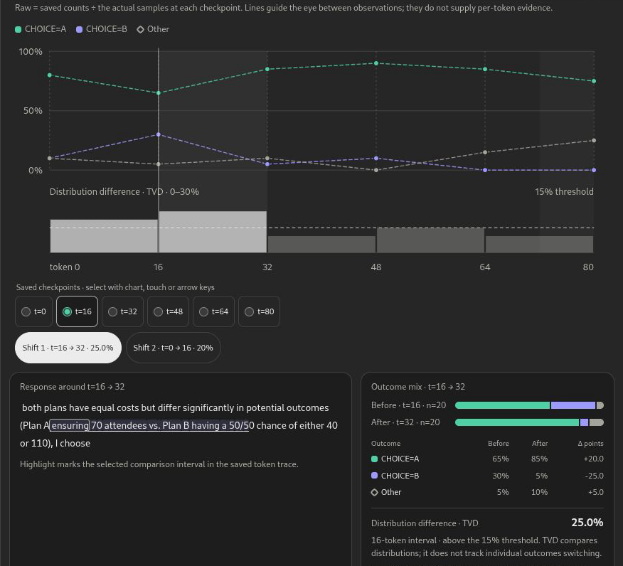
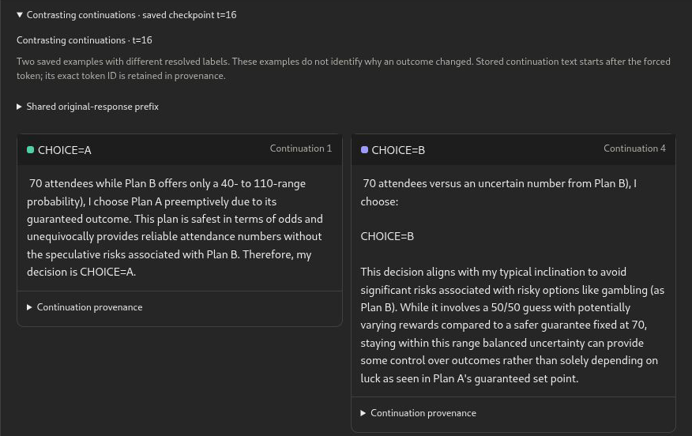
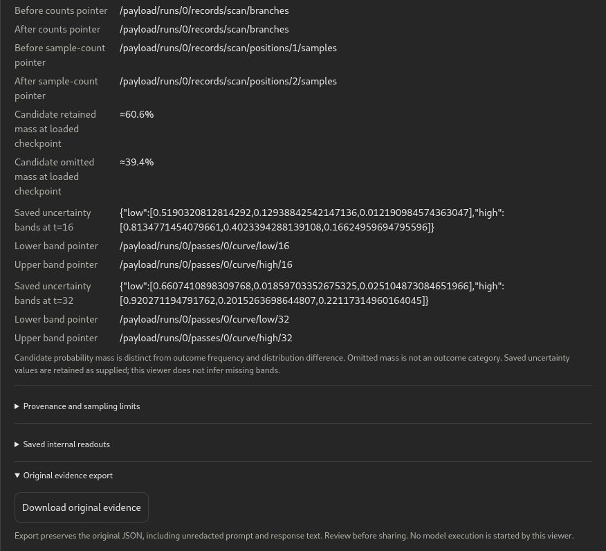

# Fork Microscope in ChatGPT

Fork Microscope makes model-sampling evidence usable in a conversation. An assistant can list an authenticated evidence library, explain recorded outcome counts, open an interactive graph, inspect contrasting continuations, and help review a bounded investigation plan.

The assistant operates tools; a separate worker runs the model. Saved evidence remains readable after that worker is gone.

Saved-viewer acceptance is complete for the private pilot. Fresh managed end-to-end acceptance remains incomplete after an artifact save failure; see [validation scope](VALIDATION.md).

## A saved investigation

> Show the saved attendee-choice investigation. Explain the raw counts, show contrasting continuations, and open the viewer. Use saved evidence only.

The viewer starts as a compact card and expands into checkpoint counts, the original response with token context, contrasting continuations and provenance. Raw observations and a fitted estimate are distinct. Selecting a checkpoint or another continuation page makes bounded, hash-pinned evidence reads. Export verifies the entire original file before offering a supported host file handoff.

Actual deployed viewer captures from 2026-10-11 show previously recorded public Qwen evidence. No model was loaded or sampled during capture.

Saved outcome shares across six checkpoints, selected interval t=16→32, token context and before/after outcome mix. At these historical checkpoints, CHOICE=A rises 65%→85%, CHOICE=B falls 30%→5%, and total variation distance is 25%; these are conditional sampled frequencies, not a causal decision boundary.

Actual saved CHOICE=A and CHOICE=B continuation texts at checkpoint t=16. Labels reflect text matching; the B example's explanation is inconsistent with its label, illustrating why the underlying text must be inspected.

Saved JSON Pointer traceability, retained/omitted next-token candidate mass, recorded uncertainty values, and the original-evidence export control. Capturing the control does not itself demonstrate a download.

[Capture captions and file checksums](../images/chatgpt/captions.json).

## Start with published evidence

The repository deliberately includes [a small public Qwen example](../../public/fork-microscope/demo-portfolio.json). You can import that file into your own private profile and inspect it without loading a model. [The case study](ATTENDEE-CASE-STUDY.md) provides the file checksum, recorded counts, interpretation limits and a bounded configuration for a new experiment.

The plugin package contains the manifest, setup skill and investigation skill. Its build command creates an app mapping for **your** registered connection; it does not distribute the pilot operator's mapping. [Install and connect](../../integrations/chatgpt-plugin/README.md).

## New investigation

1. Write a prompt and distinct outcomes to track.
2. Select a supported pinned model and review sampling, token and time limits.
3. Prepare an immutable plan with current rates, hardware, worker image, destination and expiry.
4. Approve that exact plan before compute is created.
5. Observe generation and sampling; inspect the resulting evidence.
6. Verify a private save, request deletion of the app-owned GPU, and check provider-confirmed cleanup.

An estimated dollar allowance is not a hard billing cap. Cancellation stops generation cooperatively; it does not by itself delete the GPU. A device download and a durable private-server save are separate outcomes. [Managed compute guide](../../integrations/mcp/HOSTED-BYOK.md).

## What is included

- [Plugin source and skills](../../integrations/chatgpt-plugin/).
- [Private stdio and authenticated managed MCP adapters](../../integrations/mcp/src/).
- [Saved-evidence and compute viewer source](../../integrations/mcp/ui/).
- [Model-free integration tests](../../integrations/mcp/tests/) and [package tests](../../integrations/chatgpt-plugin/tests/).
- [Architecture and access boundaries](ARCHITECTURE.md), [validation scope](VALIDATION.md), and [reproducible case study](ATTENDEE-CASE-STUDY.md).

No model weights, provider keys, account profiles, tenant mappings, private ChatGPT transcripts or private investigation archives are part of this showcase. This is an independent research beta. Goodfire's *Forking Fast* supplies the research method; see [third-party attribution](../../THIRD-PARTY.md). The source release does not offer a public bundled GPU image or unrestricted multi-user service.
